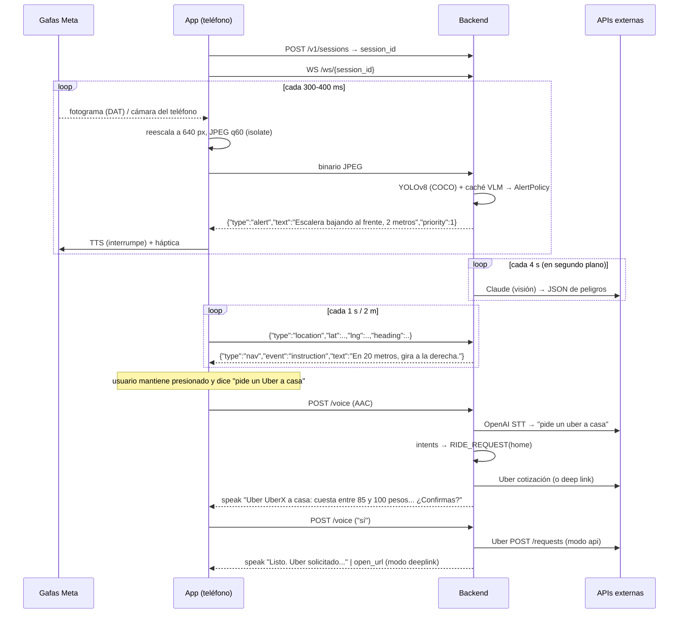

# Arquitectura de Faro

## 1. Flujo de datos extremo a extremo



### Por qué el procesamiento pesado va en el backend
* El usuario pidió explícitamente un backend Python de IA; además permite GPU compartida, actualizar modelos sin publicar en tiendas y usar Claude/OpenAI con claves que nunca viajan al teléfono.
* El coste es ~100-150 ms de red por fotograma. A velocidad peatonal (1,3 m/s) son ~20 cm: aceptable.
* **Hoja de ruta:** exportar YOLO a TFLite/CoreML (`training/train_hazards.py --export`) y ejecutarlo en el teléfono para que las alertas sigan funcionando sin cobertura; el backend queda para VLM, navegación y Uber.

## 2. Protocolo app ↔ backend

Autenticación: cabecera `X-API-Key` (REST) o `?key=` (WebSocket) con `API_SHARED_SECRET`. En producción sustituir por tokens por usuario (Firebase Auth / Auth0) — ver `docs/LAUNCH.md`.

### Mensajes de la app
| Canal | Contenido |
|---|---|
| WS binario | fotograma JPEG |
| WS texto | `{"type":"location","lat","lng","heading","speed","accuracy"}` · `{"type":"utterance","text"}` · `{"type":"ping"}` |
| `POST /v1/sessions/{id}/voice` | multipart `file` (m4a/wav) + `language` |
| `POST /v1/sessions/{id}/frame` | alternativa REST al WS (cuerpo = JPEG) |
| `PUT /v1/sessions/{id}/places` | lugares guardados (`home`, `work`, …) |

### Mensajes del backend
| `type` | Campos | La app… |
|---|---|---|
| `alert` | `text, priority (0-3), hazard, zone, distance_m, interrupt` | habla interrumpiendo si `interrupt`, vibra `danger`/`warning` |
| `speak` | `text, priority, interrupt` | encola en el TTS |
| `nav` | `event (start/instruction/progress/correction/reroute/arrived), text, priority` | habla; `arrived` vibra `success` |
| `haptic` | `pattern` | vibra |
| `open_url` | `url` | abre la app de Uber (deep link) |
| `state` | `navigating, pending, alerts_enabled, ride_active, has_position` | actualiza la UI/semántica |
| `ride_status` | datos del viaje | opcional: anunciar cambios |
| `error` | `message` | log |

## 3. Módulo de visión

```
JPEG ─► PIL ─► YoloDetector (COCO) ──┐
                                     ├─► detecciones ─► AlertPolicy ─► 0..1 Alert
       caché VLM (Claude, cada 4 s) ─┘
```

* **Taxonomía** (`hazards.py`): `stairs_down, stairs_up, hanging_cable, pole, pothole, curb, vehicle, bicycle, person, animal, obstacle`. Prioridad 0 = vehículo; 1 = escalera bajando, bache, cable; 2 = bici, poste, escalera subiendo, escalón; 3 = persona, animal, obstáculo.
* **Posición**: tercios horizontales (izquierda / al frente / derecha) y verticales (arriba para cables).
* **Distancia**: pinhole `d = H_real · f / h_px` para clases con altura conocida (persona 1,70 m, coche 1,50 m…); si no, cualitativa por área (muy cerca / cerca). El VLM entrega su propia estimación.
* **Política** (`alert_policy.py`): relevancia por distancia (8 m; vehículos 15 m) → orden (prioridad, distancia, confianza) → cooldown 3 s por (peligro, zona) salvo acercamiento >30 % → intervalo mínimo 1,2 s entre alertas salvo prioridad 0.
* **VLM** (`vlm.py`): Claude con salida estructurada (`output_config.format = json_schema`), esfuerzo `low`, imagen ≤768 px, timeout 8 s, `fallbacks: "default"`; se ejecuta como tarea en segundo plano en modo `hybrid`. También responde a *"¿qué hay delante?"* con dos frases.
* **Modelo fine-tuned** (`training/`): YOLOv8n con 6 clases propias. Hasta tenerlo, el VLM cubre esos peligros.

## 4. Navegación peatonal

* `google_maps.py`: `computeRoutes` con `travelMode=WALK`, `languageCode=es`, máscara de campos con `navigationInstruction` (maniobra + texto), polilíneas por paso; Places Text Search (New) con sesgo de ubicación para "la farmacia"; Geocoding inverso para "¿dónde estoy?".
* `guidance.py` (`RouteGuide.update(lat, lon, heading)`):
  1. llegada (≤10 m) → *"Has llegado a X. El destino está a las 2 en punto."*
  2. fuera de ruta (>25 m en 3 posiciones) → evento `reroute` → el asistente recalcula.
  3. fin de paso (≤8 m) → *"Gira a la derecha hacia Calle Madero. Camina 60 metros hacia el este."*
  4. preaviso a 15-30 m → *"En 20 metros, gira a la derecha."*
  5. corrección de rumbo si el usuario mira >35° fuera de la dirección correcta durante 3 s → *"Gira ligeramente a la izquierda para seguir la ruta."*
  6. progreso cada 40 m → *"Sigue recto 60 metros hacia el norte."*
* La brújula del teléfono es el rumbo de referencia (el rumbo GPS es inútil a paso de peatón). Con las gafas Meta no hay IMU accesible desde terceros hoy; cuando lo haya, usar el rumbo de la cabeza.

## 5. Uber

* `UberDeepLinkProvider` (por defecto): construye `https://m.uber.com/ul/?action=setPickup&client_id=…&pickup[latitude]…&dropoff[latitude]…&dropoff[nickname]=Casa`. La app lo abre; Uber (accesible con VoiceOver/TalkBack) muestra precio y botón de confirmar.
* `UberApiClient`: OAuth 2.0 (code), `GET /products`, `POST /requests/estimate` (fare_id), `POST /requests`, `GET/DELETE /requests/current`, sandbox por defecto. Requiere scope privilegiado `request` aprobado por Uber.
* `RideFlow`: cotiza → guarda `PendingAction(kind="ride", expira en 45 s)` → el parser reconoce "sí/dale/confirmo" o "no/cancela" con contexto → solicita o cancela. Sin destino pregunta *"¿A dónde quieres ir en Uber?"* y acepta la respuesta libre.

## 6. Comandos de voz

STT (OpenAI, con vocabulario de pista) → `intents.parse_command` (reglas sobre texto normalizado sin acentos) → `Assistant`. Intenciones: navegar, pedir Uber, confirmar, cancelar, detener navegación, describir escena, dónde estoy, repetir, ayuda, guardar lugar, alertas on/off. Confirmar/cancelar exigen palabra clave explícita; muletillas ("gracias", "bueno") nunca disparan una acción.

Alternativa de menor latencia (no implementada): reconocimiento en el dispositivo (`speech_to_text`) enviando `{"type":"utterance"}` por WebSocket; el backend ya lo acepta.

## 7. Sesiones y escalado

`SessionManager` en memoria (TTL 6 h). Para varias réplicas: Redis para el estado de sesión y *sticky sessions* en el WebSocket. YOLO en CPU atiende ~10 fps por núcleo con yolov8n a 640 px; una GPU T4 ~200 fps → ~60 usuarios simultáneos a 3 fps por instancia.

## 8. Privacidad y seguridad

* Los fotogramas se procesan en memoria y no se persisten (solo el último por sesión para "¿qué hay delante?").
* Las claves de proveedores viven solo en el backend.
* Logs sin contenido de imagen ni audio; transcripciones solo a nivel `INFO` en desarrollo.
* Pendiente para producción: cifrado en reposo de tokens de Uber, borrado de sesión al cerrar la app, política de retención documentada (ver `docs/LAUNCH.md`).
